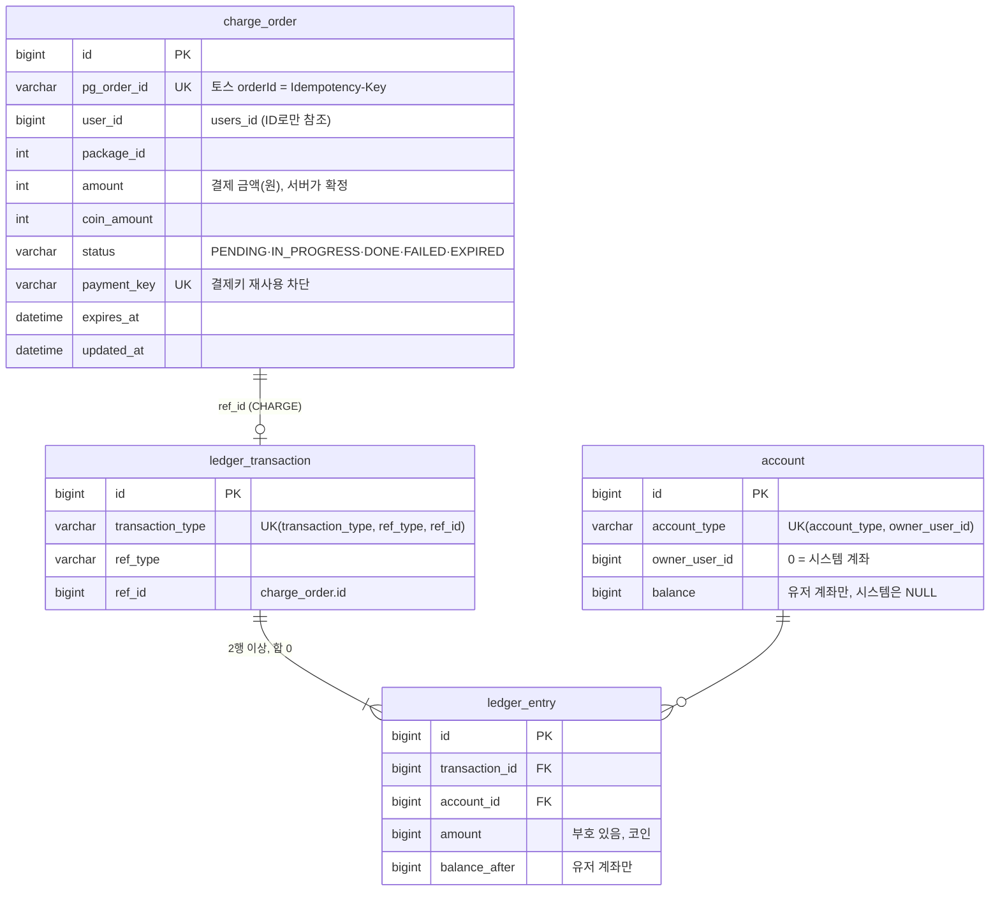
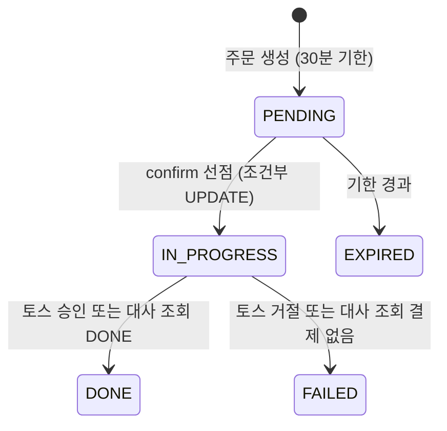

# Game's Cord — 코인 결제·지갑 정합성 재설계

게임 메이트 매칭 서비스 **Game's Cord**(팀 프로젝트)를 fork해, 기존 코인 결제 흐름에서 발견한 결함을 재현하고 **주문·지갑 도메인을 개인 확장으로 재설계**한 저장소입니다.

- 무료 충전, 중복 지급, 결제 결과 불명 같은 문제를 테스트로 먼저 재현하고 수정했습니다.
- 계정 기반 복식 원장, 주문 상태 머신, 3중 중복 방어, PG 결과 불명 대사로 돈과 코인이 어긋나지 않게 했습니다.
- Testcontainers MySQL과 WireMock(가짜 토스 서버)으로 동시성과 장애 상황을 검증했고, 전체 테스트 108개가 통과합니다.

| 링크 | |
|---|---|
| 결함 리포트 | [#2](https://github.com/YujinB/game-s-cord/issues/2) |
| 구현 PR | [#3](https://github.com/YujinB/game-s-cord/pull/3), [#4](https://github.com/YujinB/game-s-cord/pull/4) |
| 설계·트러블슈팅 상세 | [Notion](https://mini-clerk-115.notion.site/3faf2dc8bb4f8168a3f4c7288f9bc546) |

> 담당: 결제(`payment`)·지갑(`wallet`) 도메인 설계·구현 · 2026.10 –
> Java 17 · Spring Boot 3.3 · JPA · MySQL 8.0 · Toss Payments · Testcontainers · WireMock

---

## 1. 발견한 결함

기존 결제 코드를 읽고 결함 9건을 정리했고, 그중 돈·코인이 직접 어긋나는 3건을 테스트로 재현한 뒤 수정했습니다. 재현 테스트는 수정 전에 의도적으로 실패하는 커밋(`1298d89`)으로 먼저 남겼습니다.

| 결함 | 원인 | 고치기 전 | 고친 후 |
|---|---|---|---|
| 무료 충전 | 결제 없이 코인을 주는 API(`/api/coins/charge`)가 남아 있음 | 200 · PG 호출 0건 · 코인 +500,000 | 404 · 코인 0 |
| 소액 결제키로 고액 충전 | 결제키로 조회해 DONE이면 승인을 건너뛰고, 그 결제의 orderId·금액을 대조하지 않음 | 4,680원 결제키로 4,320,000원 패키지 충전 성공 | 토스 승인 요청 → 거절 · 코인 0 |
| 동시 confirm 이중 지급 | 주문을 메모리에서 꺼내기만 하고, PG 호출이 끝난 뒤에 삭제 | PG 승인 1건에 충전 2건 | 승인 1건 · 충전 1건 |

테스트는 버그 동작이 아니라 **불변식**("PG 승인 없이 코인이 지급되지 않는다", "동일 주문에 대해 PG 승인 1건당 코인 지급은 최대 1회")으로 단언해, 수정 후에는 회귀 테스트로 남습니다.

## 2. 계정 기반 복식 원장

기존에는 `users.point`를 읽고-쓰기로 갱신했고, 거래 내역(`coin`)은 환불 시 행이 삭제돼 "잔액 = 내역 합계"를 확인할 수 없었습니다.

- `account`(잔액) · `ledger_transaction`(왜 움직였나) · `ledger_entry`(어느 계정에서 얼마)로 분리
- 거래별 entry 합이 0이 아니면 거래 생성 시 예외 → 코인이 생기거나 사라지는 기록을 구조적으로 차단
- 주문 확정 + 잔액 원자 UPDATE + 원장 기록을 한 DB 트랜잭션으로 처리
- 처음 충전하는 유저의 동시 요청이 REPEATABLE READ 스냅샷 때문에 10건 중 9건 실패하던 문제를 잠금 읽기(`SELECT ... FOR UPDATE`)로 해결



| 제약·인덱스 | 역할 |
|---|---|
| `charge_order.payment_key` UNIQUE | 결제키 하나가 두 주문에 쓰이지 못하게 막음 |
| `ledger_transaction (transaction_type, ref_type, ref_id)` UNIQUE | 같은 주문으로 코인이 두 번 지급되지 못하게 막음 (3중 방어 ③) |
| `account (account_type, owner_user_id)` UNIQUE | 유저·종류마다 계좌 하나 (시스템 계좌는 owner 0, MySQL UNIQUE가 NULL 중복을 막지 않아서) |
| `charge_order (status, updated_at)` · `(status, expires_at)` | 대사(5분 지난 IN_PROGRESS)·만료(기한 지난 PENDING) 조회 |
| `ledger_entry (account_id, id)` | 계좌별 내역 최신순 조회 |

## 3. 주문 상태 머신과 3중 방어



- 상태를 나누는 기준은 "우리 서버가 토스에 승인을 요청했느냐"입니다. PENDING은 돈이 나갔을 리 없어 기한만 보고 EXPIRED로, IN_PROGRESS는 토스에 조회한 뒤 확정합니다.
- 허용 전이는 `ChargeOrderStatus.canTransitionTo` 한 곳에 두고, 실제 전이는 `WHERE status = :from` 조건부 UPDATE로만 수행합니다.

| 층 | 막는 상황 | 방법 |
|---|---|---|
| ① 서버 진입 | 버튼 두 번 클릭, 클라이언트 재전송 | 상태·기한 조건부 UPDATE로 주문 선점 |
| ② PG 호출 | 승인 재시도 시 이중 결제 | 토스 `Idempotency-Key` = 주문번호 |
| ③ 코인 지급 | 정상 승인과 대사가 겹치는 등 지급이 두 번 실행 | 원장 `UNIQUE(transaction_type, ref_type, ref_id)` |

## 4. PG 결과 불명 복구 — 트랜잭션 분리와 대사

```
트랜잭션 1: 소유자·금액·기한 검증, PENDING → IN_PROGRESS 선점
  ↓ (트랜잭션 밖) 토스 승인 요청
트랜잭션 2: DONE + 원장 지급 (ChargeCompleter)
```

| 토스 응답 | 주문 상태 | API 응답 |
|---|---|---|
| 성공 | DONE + 지급 | 200 |
| 4xx 거절 | FAILED | 400 |
| 5xx · 타임아웃 · 409 | IN_PROGRESS 유지 (결과 모름) | 502 |

- 1분마다 IN_PROGRESS로 5분 넘게 머문 주문을 토스 주문 조회 API로 대사합니다. DONE + 금액 일치면 확정·지급, 결제 없음·ABORTED면 FAILED, 금액 불일치면 보류합니다.
- 정상 승인과 대사가 같은 확정 메서드를 거쳐, 두 경로가 겹쳐도 한 번만 지급됩니다.
- 같은 DB 안의 일이라 Kafka·Outbox 대신 트랜잭션으로 묶었습니다. PG 호출을 트랜잭션 밖으로 뺐기 때문에 지급이 실패해도 주문은 IN_PROGRESS로 남고 대사가 다시 처리합니다.

## 5. 테스트

```bash
cd backend
./gradlew test   # Docker 실행 필요 (Testcontainers MySQL 8.0)
```

| 검증 | 결과 |
|---|---|
| 같은 주문 상태 선점 동시 10건 | 1건 성공 |
| 같은 주문 지갑 지급 동시 10건 | 1건 반영, 9건 중복 거절 |
| 같은 계정 +1 동시 20건 | 잔액 정확히 20 |
| 동시 지급 후 | 계정 잔액 = 원장 entry 합계 |
| 대사 (WireMock 장애 주입) | DONE → 두 번 돌려도 지급 1번 / 5xx → IN_PROGRESS 유지 / 금액 불일치 → 보류 |

- H2 대신 MySQL 컨테이너를 쓴 이유: 조건부 UPDATE와 잠금 동작이 MySQL과 달라서입니다.
- 토스 테스트 환경으로는 타임아웃·응답 지연을 재현할 수 없어 WireMock으로 가짜 토스 서버를 띄웠습니다.

## 6. 범위와 남은 과제

- 신규 충전 흐름에 원장을 도입했습니다. 기존 매칭 기능이 아직 `users.point`를 읽기 때문에, 충전 확정 시 레거시 잔액·내역도 함께 갱신합니다. 매칭 코인 이동의 원장 전환은 다음 단계입니다.
- PG 통신 기록(`payment_history`)과 환불(DONE → CANCELED)은 아직 구현하지 않았습니다.

## 패키지 구조

```
backend/src/main/java/com/example/gamescord
├── payment/   결제: 충전 주문·상태 머신·토스 연동·대사 (application / domain / infrastructure)
├── wallet/    지갑: 계정·복식 원장 (application / domain / infrastructure)
└── controller, service, repository, domain …   팀 프로젝트 기존 코드
```

---

## 원래 팀 프로젝트

리그오브레전드·배틀그라운드·오버워치 유저가 코인을 지불하고 함께 게임할 게임 메이트를 찾는 웹 서비스입니다. 원본 저장소: [Wooong-E/game-s-cord](https://github.com/Wooong-E/game-s-cord)

<details>
<summary>팀원</summary>

| Student ID | Name |
| :--------- | :----- |
| 22112093 | 이택민 |
| 22112021 | 조웅 |
| 22112129 | 서상범 |
| 22112026 | 우영민 |
| 22110690 | 백유진 |
| 22313546 | 이성진 |
| 22112036 | 박기현 |

</details>

- 요구사항 명세·시스템 테스트: [docs/SRS.md](docs/SRS.md)
- 설계 문서: [SDS/](SDS)
